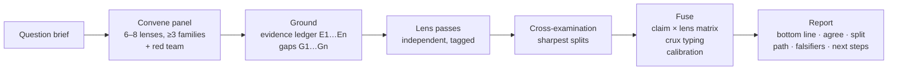

# Fusion Intelligence

**English** · [简体中文](README.zh-CN.md)

> One research question → a panel of independent reasoning lenses → grounded in evidence → **fused** into a
> calibrated answer that shows where minds agree, where they split, *why*, and what to do next.

An Agent Skill for **Claude Code**, **Codex** and **Antigravity** (and anything that reads `SKILL.md` or
`AGENTS.md`). Built for research work: study design, grant pre-review, manuscript "Reviewer 2" passes, scale
validation, prediction models, real-world databases, AI-use decisions, ethics, and choosing what to work on.

It distills the method behind [Pantheon](https://pantheon.k-dense.ai/) (80 voices, cited sources, a consensus
step) into a disciplined, reusable workflow — and fixes the part that panels usually get wrong: *agreement
between model-generated voices is not evidence.*

---

## Why not just "ask several experts"?

| Typical multi-persona prompt | Fusion Intelligence |
|---|---|
| Voices written together, so they echo each other | Each lens is written independently (parallel agents when available) |
| Opinions first, facts later (or never) | **Evidence ledger first**; every claim tagged `[E#]` / `[R]` / `[A]` |
| "Consensus" = majority or average | Claims classified: consensus · contested · single-lens hypothesis · blind spot · echo |
| Disagreement hidden in a polished summary | Every split gets a **crux type** (factual, methodological, values, definitional, scope, time) and a resolver |
| Confident tone | **Calibrated** confidence; never "High" on lens agreement alone |
| Impersonates real people | Lenses are *frameworks*; no voicing, no invented quotes |
| Ends with a summary | Ends with **no-regret moves, conditional moves, a decisive test, and falsifiers** |

## How it works



Modes: `quick` (4 lenses, ≤ 1 page) · `standard` (6–8) · `deep` (10–16 + cross-exam, parallel agents) ·
`pantheon` (all 80 in four batches, clustered into stances, then fused).

## Install

### Option 1 — the installer (recommended)

```bash
git clone https://github.com/YUAILUN/Fusion-Intelligence.git
cd Fusion-Intelligence
bash scripts/install.sh              # Claude Code + Codex + Antigravity, user-level
bash scripts/install.sh --claude     # only Claude Code
bash scripts/install.sh --project .  # install into the current project instead
bash scripts/install.sh --link       # symlink, so `git pull` updates it
```

### Option 2 — skills CLI

```bash
npx skills add YUAILUN/Fusion-Intelligence
```

### Option 3 — copy by hand

| Platform | Copy this repo to |
|---|---|
| Claude Code | `~/.claude/skills/fusion-intelligence/` (or `<project>/.claude/skills/…`) |
| Codex | `~/.agents/skills/fusion-intelligence/` (or `<project>/.agents/skills/…`) |
| Antigravity | `~/.gemini/antigravity/skills/fusion-intelligence/` (or `<project>/.agent/skills/…`) |
| Others | copy `AGENTS.md` to the project root |

Restart the agent after installing. Check the package any time: `python3 scripts/validate.py`.

## Use it

Just ask; the skill routes itself. Or call it explicitly (`/fusion-intelligence` in Claude Code,
`$fusion-intelligence` in Codex).

```text
Stress-test this idea with a panel: <idea>. Standard mode.

Run a Fusion review of my protocol (attached) as a study-design panel. I need the top 3 threats to validity.

Pre-review this grant draft like a skeptical committee. Score it and give me the 3 strongest reviewer attacks.

What would Reviewer 2 say about this manuscript? Use the matching reporting guideline.

Fusion panel, deep mode: should we build a perioperative delirium prediction model on this registry?

Pantheon mode: why do we still not have a cure for ALS?   # 80 lenses, clustered
```

```text
用融合智能对这个研究想法做压力测试，标准模式：<想法>
请用"量表研制"面板审查我的量表汉化与验证方案，按 COSMIN 的顺序给出缺口。
把这份课题申请书当作评审会预审：打分、指出三个最可能被攻击的点，并给出改写优先级。
深度模式：这个围手术期数据库适合做预测模型吗？
```

## What is inside

```
SKILL.md                    the skill: workflow, rules, router, quality gates
AGENTS.md                   compact fallback for agents that do not load skills
references/
  lens-library.md           80 lenses (4 families) + 7 role lenses, as lens cards
  panel-presets.md          17 research panels + quick-mode reductions
  fusion-protocol.md        claim matrix, crux typing, calibration, anti-patterns
  lens-pass-template.md     prompt + schema for one lens (subagent-ready)
  evidence-grounding.md     ledger, strength tags, citation rules
  report-templates.md       full / brief / grant scorecard / Reviewer-2 / design memo (EN + 中文)
  research-checklists.md    reporting guidelines, causal, COSMIN-style, prediction, ethics
  platform-notes.md         Claude Code / Codex / Antigravity specifics
examples/                   what a finished report looks like
scripts/install.sh          multi-platform installer
scripts/validate.py         package validator
agents/openai.yaml          Codex UI metadata
```

## Design principles

1. **Structure creates diversity.** Different frameworks, forced questions and assigned stances — not
   different "voices" — are what make perspectives genuinely differ.
2. **Disagreement is data.** Surface it, type it, say what would resolve it.
3. **Evidence is shared, reasoning is independent.** One ledger, many passes.
4. **Calibration over confidence.** Say what would change your mind.
5. **Frameworks, not people.** No impersonation; no fabricated quotes.
6. **Honest scope.** A panel of model-generated lenses structures thinking; it adds no independent expertise
   or data. It is a second opinion to challenge, not an oracle.

## Safety and limits

- Not medical, legal or financial advice; clinical decisions remain with qualified professionals; the ethics
  committee decides ethics.
- Do not paste identifiable participant or patient data.
- Lens cards are compressed interpretations of public work and can be wrong; the upstream files are the source.
- Citations must be verified. The skill is instructed never to invent references; you should still check.

## Credits and license

Method inspired by **Pantheon** and lens frameworks compressed from **Mimeographs**, both by
[K-Dense](https://k-dense.ai/) (MIT). This project is independent and not affiliated; see
[NOTICE.md](NOTICE.md). Released under the [MIT License](LICENSE).

## Contributing

Add or sharpen a lens, a preset or a checklist: edit `references/…`, run `python3 scripts/validate.py`, open a
PR. Please keep cards to framework-level claims you can trace to public work, and keep the red-team lens in
every preset.
